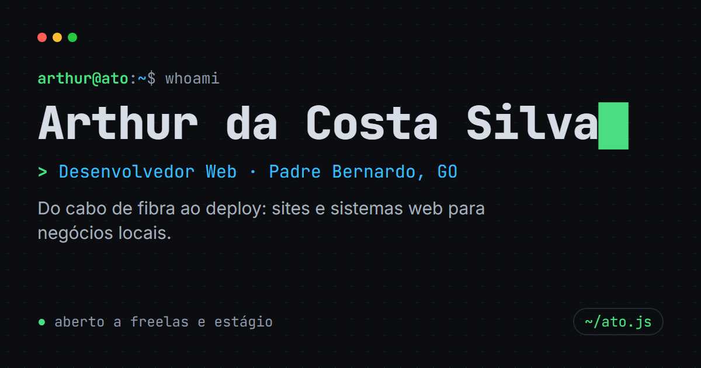

# ~/ato.js: portfólio de Arthur da Costa Silva

Portfólio de **Arthur da Costa Silva** ([@ato.js](https://instagram.com/ato.js)), desenvolvedor web em Padre Bernardo, GO. A página inteira funciona como um desktop Linux: boot estilo systemd, barra de áreas de trabalho no estilo i3, statusline do vim e um terminal de verdade.



**Stack:** React 19 · Vite 8 · CSS puro · HTML pré-renderizado · deploy na Vercel

## O que tem

- **Boot** estilo systemd na primeira visita da sessão (qualquer tecla pula; some com "reduzir movimento")
- **Terminal interativo** estilo Quake: abre com <kbd>:</kbd>, a tecla abaixo do <kbd>Esc</kbd> ou <kbd>Ctrl</kbd>+<kbd>K</kbd>. Tem ~30 comandos, autocompletar com Tab, histórico com ↑↓ e easter eggs (`sudo contratar`, `matrix`, `vim`, `cowsay`…)
- **6 temas**: ato, dracula, gruvbox, catppuccin, amber (CRT) e light. Pela barra superior ou `tema <nome>`
- **Projetos com print real** que rola a página inteira no hover (e sozinho no celular)
- **Atividade ao vivo**: últimos commits puxados da API do GitHub
- **`./orcamento.sh`**: formulário que monta a mensagem e abre o WhatsApp
- **SEO**: HTML pré-renderizado, Open Graph com imagem, JSON-LD, sitemap e robots
- **Segurança**: Content-Security-Policy com hash do script inline e cabeçalhos em `vercel.json`
- **Acessibilidade**: navegação por teclado, foco visível, leitores de tela e `prefers-reduced-motion`

## Rodando local

```bash
npm install
npm run dev       # http://localhost:5173
```

| Comando           | O que faz                                                        |
| ----------------- | ---------------------------------------------------------------- |
| `npm run dev`     | servidor local com hot reload                                    |
| `npm run build`   | build + pré-renderização em `dist/` (HTML, 404, sitemap, robots) |
| `npm run preview` | serve o `dist/` para testar o build                              |
| `npm run lint`    | verifica o código com oxlint                                     |
| `npm run shots`   | refaz os prints dos projetos, `og.png` e o ícone (Playwright)    |

## Estrutura

```
src/
├── data.js              ← TODO o conteúdo: perfil, projetos, serviços, trajetória
├── App.jsx              ← monta a página e os atalhos de teclado
├── components/          ← uma seção por arquivo + CSS ao lado
├── terminal/
│   ├── comandos.jsx     ← todos os comandos do terminal
│   ├── Terminal.jsx     ← interface (histórico, Tab, foco)
│   └── Matrix.jsx       ← easter egg (comando `matrix` ou código Konami)
├── lib/                 ← tema, estado do terminal, hooks, GitHub, WhatsApp
├── styles/              ← temas (tokens de cor) e estilos base
├── main.jsx             ← entrada do navegador (hidrata o HTML pronto)
└── entry-server.jsx     ← entrada da pré-renderização
scripts/
├── prerender.mjs        ← gera o HTML final, CSP, 404, sitemap e robots
└── shots.mjs            ← tira os prints dos projetos com Playwright
public/                  ← favicon, og.png e prints em projetos/
```

## Editando o conteúdo

Tudo que aparece no site (e no terminal) vem de [`src/data.js`](src/data.js). Para adicionar um projeto:

1. Adicione o objeto em `projetos` (o primeiro da lista ganha o card grande).
2. Rode `npm run shots -- <slug>` para gerar `public/projetos/<slug>.webp`.
   Se o site estiver fora do ar ou protegido, aponte para outro endereço: `npm run shots -- <slug> http://localhost:4173`.

## Deploy

Importe o repositório na [Vercel](https://vercel.com/new); ela detecta o Vite sozinha. Cada push na `main` publica uma nova versão.

- O endereço usado no Open Graph, sitemap e canonical vem de `VERCEL_PROJECT_PRODUCTION_URL`. Com domínio próprio, defina `SITE_URL` (ex.: `https://atojs.com.br`) nas variáveis de ambiente do projeto.
- Ative **Analytics** no painel do projeto para contar visitas (sem cookies).
